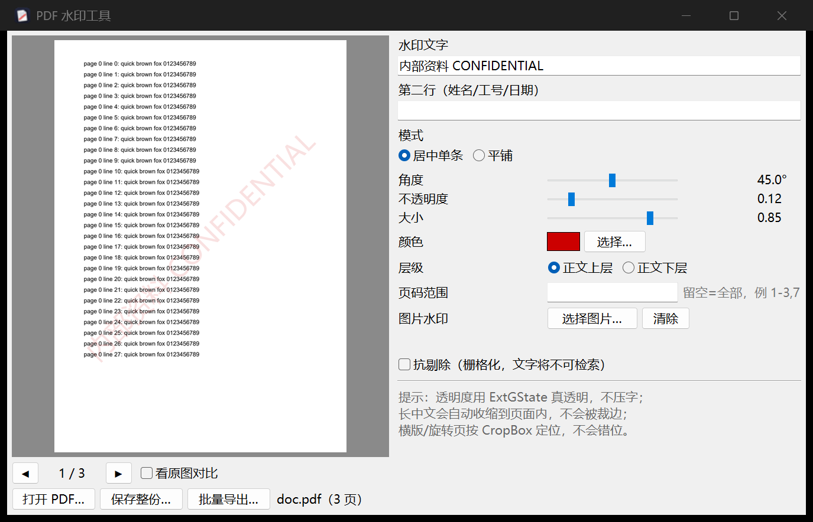

# PDF 水印工具 (pdfwm)

可视化给 PDF 加水印：左侧实时预览、翻页、原图对比，右侧调参，一键应用到整份文档。支持**每人一份唯一水印**的批量导出，以及**抗剔除**的栅格化输出。



## 为什么自己写一个

商业 GUI（Acrobat / PDF-XChange）只能套模板，而"加个水印"这件事实际有四个坑，套模板的工具全踩：

1. **透明度必须走 ExtGState（CA/ca）**，不能把颜色调浅 —— 调浅会在正文上形成实色膜，压字。
2. **斜放的长中文一定会撞页边**：45° 时文字水平投影是 `tw·cosθ + size·sinθ`，必须解这个不等式反推字号，否则开头几个字被裁掉。
3. **旋转页 / 横版页**要先 `transfer_rotation_to_content()` 把 `/Rotate` 烘进内容流再画，否则水印跟着页面转 90°。
4. **定位要按 CropBox**，不能假设 A4，裁切过的页面才会对齐。

这个工具把四条都处理了，并且预览与导出走**同一条绘制代码**，所以预览所见即成品。

## 功能

| 项目 | 说明 |
|---|---|
| 文字水印 | 任意中英文，自动选系统字体（微软雅黑 / 黑体 / 宋体） |
| 第二行 | 姓名 / 工号 / 日期，用于溯源；平铺模式下每格都带 |
| 图片水印 | PNG/JPG logo，居中或平铺 |
| 模式 | 居中单条 / 平铺（保证至少 2 列，不会退化成单条） |
| 角度 / 不透明度 / 大小 / 颜色 | 0–90°、0.02–0.60、相对页宽、任意取色 |
| 层级 | 正文上层 / 正文下层 |
| 页码范围 | 留空=全部，例 `1-3,7` |
| 抗剔除 | 栅格化后水印进像素，`qpdf --qdf` / `mutool` 剔不掉（代价：文字不可检索） |
| 批量导出 | 读 CSV，每个收件人一份唯一水印 |

## 安装运行

```bash
pip install pypdf reportlab pypdfium2 pillow
python pdfwm_gui.py            # 打开界面
python pdfwm_gui.py 文件.pdf    # 直接打开某份 PDF
```

Windows 上也可以双击 `启动PDF水印.bat`（自动建 venv 装依赖）。

直接下载免安装单文件 exe（24 MB，Windows x64）：

**[⬇ pdfwm-v1.1.0-win64.zip](https://github.com/leon-2050/pdfwm/releases/download/v1.1.0/pdfwm-v1.1.0-win64.zip)** — 解压后双击 `pdfwm-gui.exe`

自己打包（PyInstaller）：

```bash
pyinstaller --onefile --windowed --name "PDF水印工具" --icon icon.ico \
  --version-file version_info.txt --add-data "icon.ico;." \
  --hidden-import pdfwm --collect-all pypdfium2 pdfwm_gui.py
```

## 命令行

`pdfwm.py` 可单独用，便于脚本化：

```bash
# 基础
python pdfwm.py in.pdf -o out.pdf --text "内部资料 CONFIDENTIAL" --owner "张三 2026-11-06"

# 平铺防截图
python pdfwm.py in.pdf -o out.pdf --text "内部资料 DRAFT" --mode tile --angle 30 --opacity 0.07

# 只打前 3 页，放在正文下层
python pdfwm.py in.pdf -o out.pdf --text "DRAFT" --pages 1-3 --under

# 抗剔除
python pdfwm.py in.pdf -o out.pdf --text "内部资料" --flatten --flatten-dpi 200
```

## 批量：每人一份唯一水印

溯源水印的关键不是水印本身，而是**每个收件人一份唯一水印**。同一份文件发给所有人打同一个水印，等于没打。

`recipients.csv`：

```csv
file,name,email,text,owner
zhangsan,张三,zhangsan@corp.com,内部资料 仅限{name}查阅,{name} {email} 2026-11-06
lisi,李四,lisi@corp.com,内部资料 仅限{name}查阅,{name} {email} 2026-11-06
```

```bash
python pdfwm.py in.pdf --batch recipients.csv --outdir ./out --angle 40
```

`{列名}` 占位符由同行其它列填充，`file` 列是输出文件名（可省 `.pdf`）。

进一步想指认到人，可以给每个收件人的**角度做微差**（43°/45°/47°）——泄露图的角度本身就是签名。

## 透明度与抗剔除的本质取舍

矢量水印是页面内容对象，`qpdf --qdf` 或 `mutool clean` 都能删。想抗剔除只有两条路：栅格化（本项目 `--flatten`），或直接输出图片 PDF。代价是文字层消失，不可检索、不可复制。

所以：

- 内部传阅、需要检索 → 矢量水印（默认）
- 对外发送、怕被扒 → `--flatten`

水印的作用是**追溯与威慑**，不是访问控制。权限位（禁打印/禁复制）只是礼貌请求，任何库都能剥离；真正拦人的是加密的用户密码。

## 常见场景的参数

| 场景 | 模式 | 角度 | 不透明度 |
|---|---|---|---|
| 正式文档 / 合同 | 居中单条 | 45° | 0.08–0.12（>0.15 开始影响阅读） |
| 防截屏 / 拍照转发 | 平铺 | 30–45° | 0.05–0.08 |
| 溯源追泄露 | 居中 + 第二行 | 45° | 0.12 |

## 自检

打包后不看窗口能不能开——窗口开得起来、盖章时才缺库，是最常见的翻车方式。所以有一组无界面自检：

```bash
PDFWM_SELFTEST=1 python pdfwm_gui.py
```

```
OK render / body preserved / watermark text / cjk font
OK tile mode / tile repeats / rasterize strips text / rasterize renders / pages intact
```

## 文件

| 文件 | 说明 |
|---|---|
| `pdfwm.py` | 绘制引擎 + 命令行（`stamp_pdf` / `rasterize_pdf` / `run_batch`） |
| `pdfwm_gui.py` | tkinter 界面 + 自检 |
| `make_icon.py` | 生成 `icon.ico` / `icon.png` |
| `version_info.txt` | exe 版本资源 |
| `启动PDF水印.bat` | Windows 一键启动 |

## License

MIT